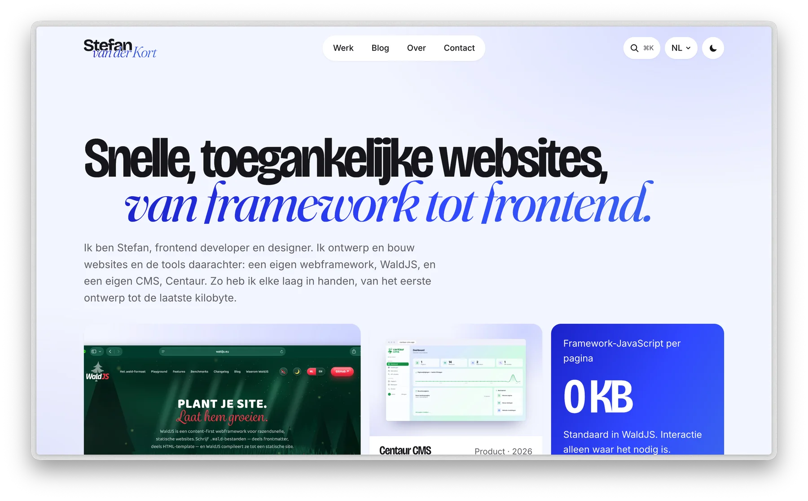

# Stefan van der Kort, mijn portfolio



Het portfolio van Stefan van der Kort, frontend developer en designer. De site draait op mijn eigen stack: het webframework [WaldJS](https://waldjs.eu), de content komt uit mijn headless CMS [Centaur](https://centaur-cms.app), en de basislaag is mijn design system [Byzantium](https://byzantium.steefan.nl).

**Live:** [www.stefanvanderkort.nl](https://www.stefanvanderkort.nl)

## 📚 Inhoudsopgave

- [Kenmerken](#-kenmerken)
- [Techniek](#%EF%B8%8F-techniek)
- [Aan de slag](#%EF%B8%8F-aan-de-slag)
- [Content uit Centaur](#-content-uit-centaur)
- [Scripts](#-scripts)
- [Deployen](#-deployen)
- [Projectstructuur](#-projectstructuur)
- [Archief](#%EF%B8%8F-archief)
- [Licentie](#-licentie)

## 🧬 Kenmerken

- **Statische HTML, 0 kB framework-JavaScript.** WaldJS bouwt elke pagina vooraf; JavaScript alleen waar het iets toevoegt (thema, zoekpalet, taalmenu, mobiel menu, lightbox, animaties).
- **Drie talen:** Nederlands (`/`), Engels (`/en`) en Duits (`/de`), met hreflang en een taalmenu.
- **Case studies** met probleem, aanpak en resultaat, een bento-galerij met lightbox en een WaldJS-playground.
- **Blog** met RSS-feeds per taal.
- **Licht en donker thema**, dat de systeeminstelling volgt of een eigen keuze onthoudt.
- **Toegankelijk:** semantische HTML, toetsenbordbediening, zichtbare focus, en animaties die `prefers-reduced-motion` respecteren.
- **SEO en GEO:** schema.org JSON-LD, `sitemap.xml` met hreflang, `robots.txt` die ook AI-crawlers toelaat, `llms.txt` en social-afbeeldingen per pagina.
- **Snel:** Lighthouse 100 op desktop en ruim 85 op mobiel, met zelf gehoste en tot de gebruikte assen beperkte fonts.
- **Build-strip:** onderaan elke pagina staat wat de build zelf heeft gemeten, zoals de grootte van de HTML en hoeveel JavaScript er meegaat.

## 🛠️ Techniek

| Onderdeel | Gebruikt |
|---|---|
| Framework | [WaldJS](https://waldjs.eu) (`.wald`-bestanden, statische build) |
| Content | [Centaur CMS](https://centaur-cms.app), opgehaald tijdens de build |
| Design system | [Byzantium](https://byzantium.steefan.nl): tokens, reset en focus, met een eigen thema |
| Animatie | CSS en [GSAP](https://gsap.com) (ScrollTrigger, SplitText), pas geladen na de pagina |
| Social-afbeeldingen | [satori](https://github.com/vercel/satori) en resvg |
| Tests | [Vitest](https://vitest.dev) en `wald check` (types) |
| Hosting | [Vercel](https://vercel.com) (Build Output API), met Vercel Web Analytics zonder cookies |
| Fonts | Bricolage Grotesque, Inter en Fraunces (OFL), zelf gehost |

## ⚙️ Aan de slag

Vereist: Node.js 22 of hoger.

```bash
npm install
cp .env.example .env   # vul de waarden in, zie hieronder
npm run dev            # http://localhost:7233
```

### Omgevingsvariabelen

| Variabele | Waar | Waarvoor |
|---|---|---|
| `CENTAUR_API_BASE` | lokaal en Vercel | Adres van de Centaur API, bv. `https://api.centaur-cms.app` |
| `CENTAUR_API_KEY` | lokaal en Vercel | Lees-sleutel van Centaur |
| `CENTAUR_TENANT_SLUG` | lokaal en Vercel | Slug van het Centaur-project (contactformulier) |
| `GITHUB_TOKEN` | optioneel | Fine-grained token met leesrechten op publieke repositories, voor het blok "Recent op GitHub" |
| `SITE_URL` | optioneel | Overschrijft het domein voor canonicals, sitemap en JSON-LD (op Vercel standaard `https://www.stefanvanderkort.nl`) |
| `CENTAUR_WRITE_KEY` | **alleen lokaal** | Schrijf-sleutel, voor de preview-modus en scripts. Nooit op Vercel zetten. |

## 📝 Content uit Centaur

Projecten, blogposts, ervaring, skills, status en klanten komen uit Centaur-collecties. Elke entry bestaat per taal en is gekoppeld via een `translation_key`.

- Alleen **gepubliceerde** content komt op de site.
- Concepten bekijken kan lokaal met de preview-modus: `CENTAUR_PREVIEW=1 npm run dev` (vereist `CENTAUR_WRITE_KEY`).
- Afbeeldingen uit Centaur worden bij de build omgezet naar het virtual-hosted adres van de object storage, omdat KPN "Veilig browsen" het andere domein blokkeert.

## 📜 Scripts

| Commando | Doet |
|---|---|
| `npm run dev` | Devserver (`wald grow`) |
| `npm run build` | Productiebuild naar `.vercel/output`, inclusief RSS, sitemap, `robots.txt`, `llms.txt`, social-afbeeldingen en build-strip |
| `npm run build:preview` | Build mét concepten uit Centaur |
| `npm run preview` | Bekijk de laatste build |
| `npm test` | Unit tests (Vitest) |
| `npm run check` | Typecheck van `.wald`- en TypeScript-bestanden |
| `npm run fonts` | Fonts opnieuw ophalen bij Google Fonts, alleen met de gebruikte assen |

## 🚀 Deployen

De site staat op Vercel. `vercel.json` zet de framework-preset uit en bouwt met `npm ci` en `npm run build`; de WaldJS-adapter schrijft de Build Output API. Een merge naar `main` zet de site live. Cache-headers staan als routes in de gebouwde `config.json` (zie `wald.config.ts`).

## 🗂️ Projectstructuur

```text
src/
├── pages/            routes: / (nl), /en, /de
├── components/       .wald-componenten (Nav, Gallery, Bento, …) en pagina's
├── layouts/          Layout.wald: <head>, meta, JSON-LD, thema
├── lib/              content, i18n, SEO, Centaur-client (met tests)
├── build/            stappen na de build: RSS, sitemap, social-afbeeldingen
└── styles/           tokens, basis en de opgenomen Byzantium-stijlen
public/               fonts, logo, favicons en kleine scripts (motion, menu, lightbox)
docs/                 specificaties, plannen en Byzantium-documentatie
```

## 🗄️ Archief

De vorige versie van dit portfolio (2024) was gebouwd met Nuxt 3, Node.js en DatoCMS.


## 💎 Licentie

Dit project valt onder de voorwaarden van de [MIT-licentie](./LICENSE). Byzantium valt ook onder MIT; zie [`public/licenses/byzantium.txt`](./public/licenses/byzantium.txt). De fonts vallen onder de SIL Open Font License.
